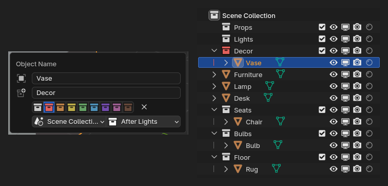

<div align="center">


# name-first

**Name every object the moment you add it, like a variable. No more `Cube.001`.**

A Blender extension · every platform · one optional setting

[](https://github.com/bayromest/name-first/stargazers)
[](https://github.com/bayromest/name-first/releases/latest)
[](https://bayromest.github.io/name-first/)
[](https://github.com/bayromest)


</div>

---

## The problem

In code, you name a variable first, then you work with it. In Blender you add a cube, get
`Cube.001`, start modeling, and an hour later your outliner is `Cylinder.004`,
`Cube.012`, `Plane.007`. You *could* press <kbd>F2</kbd> after every add. You forget.

## The fix

`name-first` opens the rename popup by itself, right after you add an object:

1. <kbd>Shift</kbd> <kbd>A</kbd> → *Cylinder*
2. The **Object Name** popup is already there, text selected. Type `Pillar`.
3. <kbd>Enter</kbd>. Done. (<kbd>Esc</kbd> keeps Blender's name.)

It works for everything in the *Add* menu: meshes, curves, surfaces, metaballs, text,
lights, cameras, empties, armatures, grease pencil, force fields, and primitives from other
add-ons. It stays quiet for things that aren't new objects (adding a modifier, a material
slot, a primitive inside Edit Mode) and for scripts.

### Optional: pick the collection, or make a new one

Forgot which collection was active? Turn on **Also ask for the collection** in the
extension's preferences (*Edit → Preferences → Add-ons → Name First*). The popup then gets
two more lines:

- **The collection list**, starting on the one the object landed in. Pick another and the
  object moves there.
- **New collection**. Press <kbd>Tab</kbd> from the name to jump to it, type a name, press
  <kbd>Enter</kbd>: the collection exists and the object is in it. It goes inside the
  collection shown in the list, at the bottom, like Blender's own *New Collection*.

  Then, only if you want: click a **color**, pick the collection it goes **inside**, and
  **where** it goes, after any collection or object, since Blender 5.3 lets the Outliner mix
  them in any order. Every change shows in the Outliner right away. **×** undoes it all.

So the whole thing can be keyboard only: <kbd>Shift</kbd> <kbd>A</kbd> → `Chair`
<kbd>Tab</kbd> `Furniture` <kbd>Enter</kbd>.



### The "Adjust Last Operation" panel keeps working

Renaming with Blender's own <kbd>F2</kbd> closes the *Adjust Last Operation* panel, so you
can no longer change the cylinder's vertices or the cube's size. `name-first` doesn't: the
panel stays open, and if you change the vertices afterwards, the object keeps the name you
typed (and the collection you picked or made).

You might think of pressing <kbd>F9</kbd> to bring the panel back after <kbd>F2</kbd>: it
doesn't work, because renaming with <kbd>F2</kbd> makes Blender forget the last operation
entirely. That's why `name-first` uses its own field instead.

## Install

### From Blender, with automatic updates (recommended)

1. In Blender, open *Edit → Preferences → Get Extensions*.
2. Open *Repositories* (top right), click **+**, then *Add Remote Repository*.
3. Paste this URL and click *Create*:

   ```text
   https://bayromest.github.io/name-first/index.json
   ```

4. Search for **Name First** and click *Install*. It works right away.

Blender now checks this repository for updates like any other extension.

### Drag and drop

Open the [Name First page](https://bayromest.github.io/name-first/) and drag the
**name_first** link into a Blender window. Blender installs it and offers to add the
repository, so you still get updates.

### Offline

Download **`name_first-1.2.0.zip`** from the [latest release](../../releases/latest) and drag
it into Blender (or *Get Extensions → ⌄ → Install from Disk*). You won't get updates this way.

**To turn it off:** disable or uninstall the extension.

## How it works

The whole extension is [one small file](extension/name_first/__init__.py):

| Step | How |
| --- | --- |
| Notice a new object | After each update, the last operator is an `…_add` and the object count went up |
| Ask for its name | Opens a popup panel, the same one <kbd>F2</kbd> shows, under the mouse |
| Rename without closing *Adjust Last Operation* | The text field lives on the window manager, which isn't part of undo, so typing in it doesn't end the operation the way <kbd>F2</kbd> does |
| Move it, or make a collection | Same trick: the list and the new-collection fields live on the window manager, and the work is done from code |
| Keep undo safe | Every change is saved as its own undo step, which Blender allows without closing *Adjust Last Operation* |
| Place a collection anywhere | Blender 5.3's Outliner order (`sort_index`), shared by collections and objects; older versions only reorder collections |
| Keep everything after a redo | Changing the vertices re-creates the object as `Cylinder`; it gets its name back, and its collection (made again if needed) |

Nothing runs in the background and no keymaps change.

## FAQ

**Can I still use F2?**
Yes, nothing about <kbd>F2</kbd> changes.

**Does it ask when I duplicate (<kbd>Shift</kbd> <kbd>D</kbd>) or import a file?**
No, only for the *Add* menu. A duplicate is usually "the same thing again".

**Can it also ask which collection the object goes in, or make a new one?**
Yes, turn on *Also ask for the collection* in the preferences. It's off by default, so the
popup stays a one-field, <kbd>Enter</kbd>-and-done thing.

**Something else opens a popup when I add objects.**
Another add-on may do the same thing. [Open an issue](https://github.com/bayromest/name-first/issues) with its name.

## Building

To validate and build the extension and regenerate the update repository in
[`docs/`](docs) (served by GitHub Pages), using Blender's own validator and builder:

```bash
python tools/build_extension.py "C:\path\to\Blender\blender.exe"
```

To publish a new version: bump `version` in
[`blender_manifest.toml`](extension/name_first/blender_manifest.toml), run the command above,
then commit and push. Everyone who added the repository gets the update in Blender.

The icon and social image come from [`tools/make_images.py`](tools/make_images.py).

## Contributing

Issues and pull requests are welcome.

## License

[GPL-3.0-or-later](LICENSE), like Blender itself. Not affiliated with or endorsed by the
Blender Foundation.
